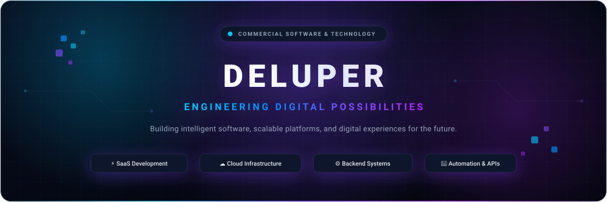

<div align="center">

  <!-- Deluper Official Logo -->
  <br />
  <a href="https://deluper.com">
    
  </a>
  <br /><br />

  <!-- Deluper Brand Banner -->
  <a href="https://deluper.com">
    
  </a>

  <br /><br />

  <!-- Quick Access Links & Status Badges -->
  <a href="https://deluper.com">
    
  </a>
  &nbsp;
  <a href="https://deluper.in">
    
  </a>
  &nbsp;
  <a href="https://github.com/Deluper">
    
  </a>
  &nbsp;
  <a href="#what-we-build">
    
  </a>

  <br /><br />

  <p align="center">
    <strong>Engineering Digital Possibilities.</strong><br />
    <em>Building intelligent software, scalable platforms, and digital experiences for the future.</em>
  </p>

  

</div>

<br />

## Who We Are

**Deluper** is an independent commercial software and technology brand dedicated to engineering resilient digital solutions, high-performance web platforms, and scalable cloud applications. We combine modern software engineering principles with intelligent automation to build software that scales reliably and transforms operational workflows.

From foundational system architecture to modern full-stack application development, Deluper designs and implements digital products built for longevity, performance, and security.

### Core Focus Areas

- 🌐 **Modern Software Engineering** — Clean, maintainable architectures following industry standards and robust testing paradigms.
- ⚡ **SaaS Product Development** — Multi-tenant, subscription-ready cloud platforms engineered for linear scalability.
- ☁️ **Cloud-Native Solutions** — Elastic containerized infrastructure and automated CI/CD deployment pipelines.
- ⚙️ **API & Backend Systems** — High-throughput microservices, low-latency RESTful APIs, and distributed event-driven systems.
- 🤖 **Intelligent Automation** — Workflow orchestration and systems integrations that streamline operational complexity.
- 🛡️ **Enterprise Software Engineering** — Resilient, data-driven software solutions tailored to mission-critical business requirements.

<br />

<div align="center">
  
</div>

<br />

## What We Build

Deluper specializes in full-lifecycle software development, providing technical capabilities that turn complex engineering requirements into seamless digital products.

<table>
  <thead>
    <tr>
      <th width="50%">Domain</th>
      <th width="50%">Engineering Scope</th>
    </tr>
  </thead>
  <tbody>
    <tr>
      <td>
        <strong>🌐 Web Engineering</strong><br />
        <sub>Modern, responsive, high-performance web applications</sub>
      </td>
      <td>
        End-to-end full stack development utilizing reactive frontend frameworks, fluid user interfaces, server-side rendering, and responsive design systems.
      </td>
    </tr>
    <tr>
      <td>
        <strong>⚡ SaaS Development</strong><br />
        <sub>Scalable subscription-based software platforms</sub>
      </td>
      <td>
        Robust multi-tenant architectures, secure authentication lifecycles, metered billing integrations, and isolated data models designed for sustainable growth.
      </td>
    </tr>
    <tr>
      <td>
        <strong>⚙️ Backend &amp; API Systems</strong><br />
        <sub>Secure APIs, microservices, and distributed architectures</sub>
      </td>
      <td>
        High-concurrency backend services, performant RESTful APIs, decoupled microservices, and reliable asynchronous event streaming pipelines.
      </td>
    </tr>
    <tr>
      <td>
        <strong>☁️ Cloud &amp; Infrastructure</strong><br />
        <sub>Cloud-ready applications and deployment environments</sub>
      </td>
      <td>
        Containerized Docker workflows, edge computing with Cloudflare, Linux server orchestration, and resilient DevOps automation.
      </td>
    </tr>
    <tr>
      <td>
        <strong>🤖 Intelligent Automation</strong><br />
        <sub>Workflow automation &amp; business process optimization</sub>
      </td>
      <td>
        Custom automated pipelines, webhook bridges, scheduled background workers, and cross-platform integrations to eliminate operational friction.
      </td>
    </tr>
    <tr>
      <td>
        <strong>🏢 Enterprise Solutions</strong><br />
        <sub>Custom software designed around business requirements</sub>
      </td>
      <td>
        Bespoke internal platforms, centralized business dashboards, management systems, and automated data processing tools built for enterprise scale.
      </td>
    </tr>
    <tr>
      <td>
        <strong>🛠️ Developer Platforms</strong><br />
        <sub>Reusable engineering tools and software foundations</sub>
      </td>
      <td>
        Modular open-source components, developer utilities, client SDKs, and standardized boilerplate architectures that accelerate product velocity.
      </td>
    </tr>
    <tr>
      <td>
        <strong>📈 Digital Transformation</strong><br />
        <sub>Modernizing legacy systems with future-ready tech</sub>
      </td>
      <td>
        Architectural refactoring, cloud migration strategies, database optimization, and modern security compliance integration.
      </td>
    </tr>
  </tbody>
</table>

<br />

<div align="center">
  
</div>

<br />

## Technologies & Engineering

Our engineering capabilities span modern programming languages, cloud environments, container systems, and scalable database technologies.

### Frontend Engineering
<p>
  
  &nbsp;
  
  &nbsp;
  
  &nbsp;
  
  &nbsp;
  
  &nbsp;
  
</p>

### Backend & Runtimes
<p>
  
  &nbsp;
  
  &nbsp;
  
  &nbsp;
  
</p>

### Databases & Cache
<p>
  
  &nbsp;
  
  &nbsp;
  
</p>

### Cloud & Infrastructure
<p>
  
  &nbsp;
  
  &nbsp;
  
  &nbsp;
  
  &nbsp;
  
</p>

### Architectural Patterns
<p>
  
  &nbsp;
  
  &nbsp;
  
  &nbsp;
  
</p>

> *Technical capabilities represent core engineering competencies and architecture domains utilized across Deluper technology solutions.*

<br />

<div align="center">
  
</div>

<br />

## How We Engineer

Deluper operates on four foundational engineering principles that guide technical decisions, system design, and software delivery:

<table>
  <tr>
    <td width="50%" valign="top">
      <h3><code>01</code> Design for Scale</h3>
      <p>Systems are architected from the ground up for linear growth, elastic workload distribution, and modular isolation. We design software that adapts effortlessly to surging user demand and evolving business needs.</p>
    </td>
    <td width="50%" valign="top">
      <h3><code>02</code> Security by Design</h3>
      <p>Security is integrated into every layer of our development lifecycle. From strict authentication protocols and data encryption to automated vulnerability scanning, resilience is never an afterthought.</p>
    </td>
  </tr>
  <tr>
    <td width="50%" valign="top">
      <h3><code>03</code> Performance Matters</h3>
      <p>Speed, efficiency, and resource optimization are non-negotiable. We engineer low-latency APIs, streamline database queries, minimize bundle payloads, and implement aggressive caching hierarchies.</p>
    </td>
    <td width="50%" valign="top">
      <h3><code>04</code> Continuous Innovation</h3>
      <p>Technology constantly evolves, and so do our engineering practices. We embrace modern standards, automate repetitive workflows, and iterate continuously to deliver lasting software value.</p>
    </td>
  </tr>
</table>

<br />

<div align="center">
  
</div>

<br />

## Our Products & Open Source

Deluper actively designs and engineers proprietary SaaS platforms, digital products, and developer-centric open-source utilities.

```
┌────────────────────────────────────────────────────────────────────────┐
│                        Deluper Software Ecosystem                      │
│                                                                        │
│   ✦ Active Development: Next-generation SaaS platforms & dev tools     │
│   ✦ Upcoming Releases: Open-source developer libraries & SDKs         │
│   ✦ Continuous Integration: Verified quality and security pipelines   │
└────────────────────────────────────────────────────────────────────────┘
```

> **Ecosystem Updates:** Public repositories, software components, and open-source releases will be published in this organization as they achieve public deployment milestones. Follow **[@Deluper](https://github.com/Deluper)** to receive notifications on upcoming releases.

<br />

<div align="center">
  
</div>

<br />

## Build With Deluper

Deluper collaborates with organizations and founders to solve complex technical challenges, engineer scalable platforms, and turn digital concepts into production-grade reality.

<div align="center">
  <h3>Have an idea? Let's engineer what's next.</h3>
  <p>Discover our capabilities, explore digital solutions, or discuss technical collaboration.</p>

  <a href="https://deluper.com">
    
  </a>
  &nbsp;
  <a href="https://deluper.in">
    
  </a>
</div>

<br /><br />

<div align="center">

  <!-- Deluper Footer Banner -->
  <a href="https://deluper.com">
    
  </a>

  <br /><br />

  <p>
    <a href="https://deluper.com">Official Website</a> &nbsp;•&nbsp;
    <a href="https://deluper.in">Development Platform</a> &nbsp;•&nbsp;
    <a href="https://github.com/Deluper">GitHub Organization</a>
  </p>

  <sub>© Deluper. All rights reserved. Engineering Digital Possibilities.</sub>

</div>
